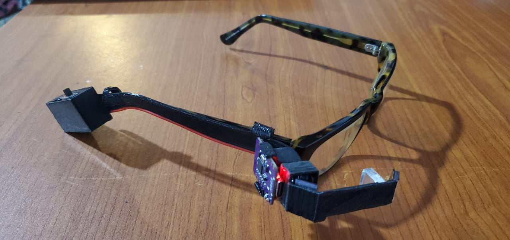

# Minimal AR

### A Voice-First Wearable Interface for Human–AI Interaction

**An independent experimental design project by Dr. Kamal D. Wasala**  
Senior Lecturer in Design | University of Moratuwa, Sri Lanka

---

## Rethinking Wearable AI Interaction

**What if the future of wearable AI doesn't require a large screen?**

Minimal AR is an experimental wearable interface exploring how voice interaction, artificial intelligence, and minimal visual feedback can work together to create more natural, hands-free human–AI experiences.

Rather than attempting to replicate conventional augmented reality glasses, this project explores a simpler alternative:

**Voice as the primary interaction. Visual information only when necessary.**

The goal is to investigate how meaningful AI interactions can be supported through small, contextual visual cues rather than complex graphical interfaces.

## The System

The project brings together three experimental components:

**1. Voice-First Interaction**

A smartphone-based voice interface, developed through experiments with a custom Whisper Button application, provides the foundation for hands-free interaction with AI.

**2. Minimal Head-Mounted Display**

A low-cost wearable display prototype using ESP32 microcontrollers, a miniature OLED screen, experimental optics, and custom-fabricated mounting structures.

**3. AI-Assisted Interaction**

Exploring how conversational AI can support everyday tasks through speech, complemented by short visual messages, notifications, and interaction indicators.

The components are at different stages of development and are being progressively integrated.

## Design Philosophy

- **Voice first:** Natural speech as the primary interaction method.
- **Minimal visual information:** Show only what is useful at the moment.
- **Accessible technology:** Experiment with affordable, readily available components.
- **Design-led development:** Start with human interaction rather than technological complexity.
- **Open experimentation:** Share the process, challenges, and discoveries.

## Hardware Exploration

The prototype development includes:

- ESP32 and ESP32-C3 microcontrollers
- Miniature OLED display (72 × 40 pixels)
- Optical lenses and reflective arrangements
- 3D-printed experimental mounting structures
- Arduino-based display programming
- Compact battery-powered configurations

## Interaction Possibilities

The project explores visual feedback for:

- Listening, processing, and responding
- Short AI-generated messages
- Contextual reminders
- Timers and task progress
- Notifications
- Future context-aware interactions

These represent a combination of current experiments and future development directions.

## Why This Project Matters

Emerging technologies, AI-assisted programming, accessible electronics, and desktop fabrication are changing who can participate in technological innovation.

This project demonstrates how a product designer can independently explore advanced wearable interaction concepts without the resources traditionally associated with large technology companies.

**The opportunity to innovate is increasingly shifting from specialised laboratories to individual desktops.**

## Prototype Demonstration

[Watch Minimal AR — Prototype 01 on YouTube](https://youtu.be/iFnnCJ3miUE)

## Current Status

**Experimental development | October 2026**

Working display experiments and early wearable prototypes have been developed. Voice interaction, display integration, optical improvements, and interaction design remain ongoing areas of exploration.

## About the Creator

**Dr. Kamal D. Wasala**  
Senior Lecturer in Design  
Department of Integrated Design  
Faculty of Architecture  
University of Moratuwa, Sri Lanka

Research interests include human–robot interaction, product design, emotional expression in non-humanoid social robots, wearable technologies, and emerging human–AI interfaces.

---

*An independent, evolving design research and prototyping project. Technical documentation, code, photographs, and further development updates will be shared progressively.*
